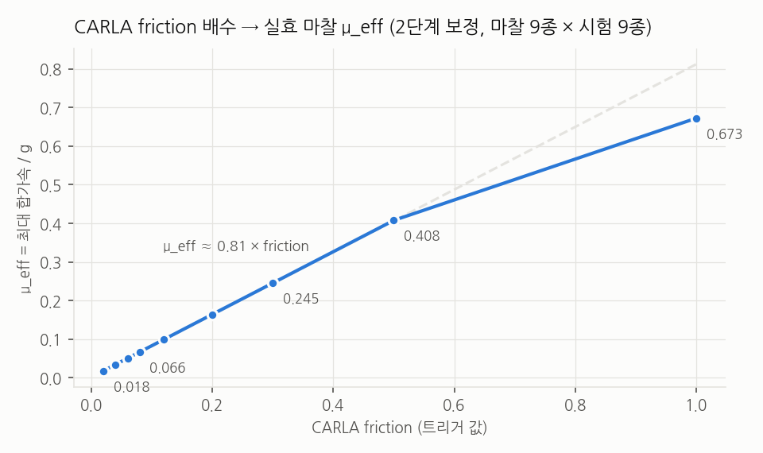
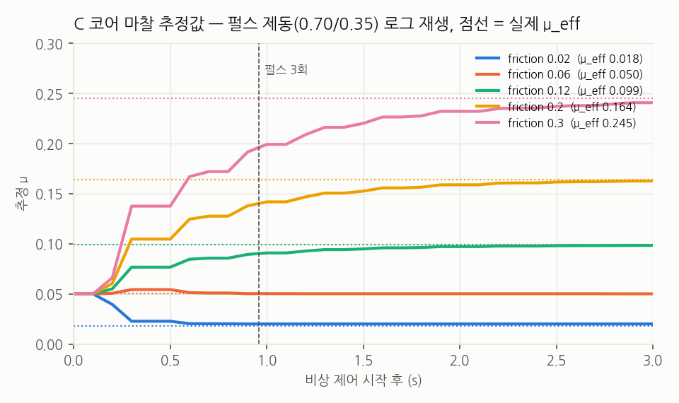
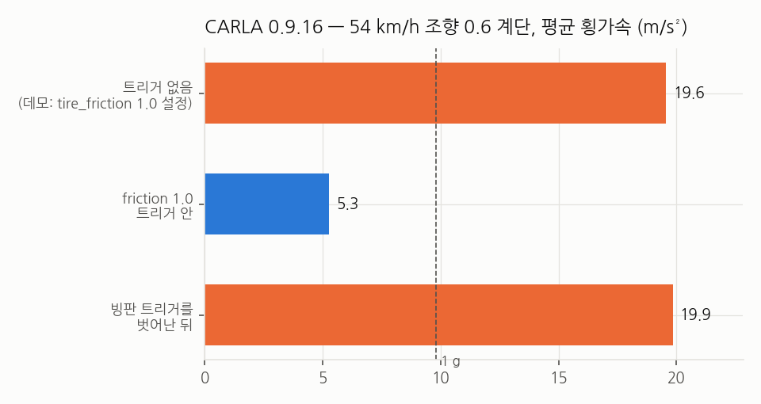
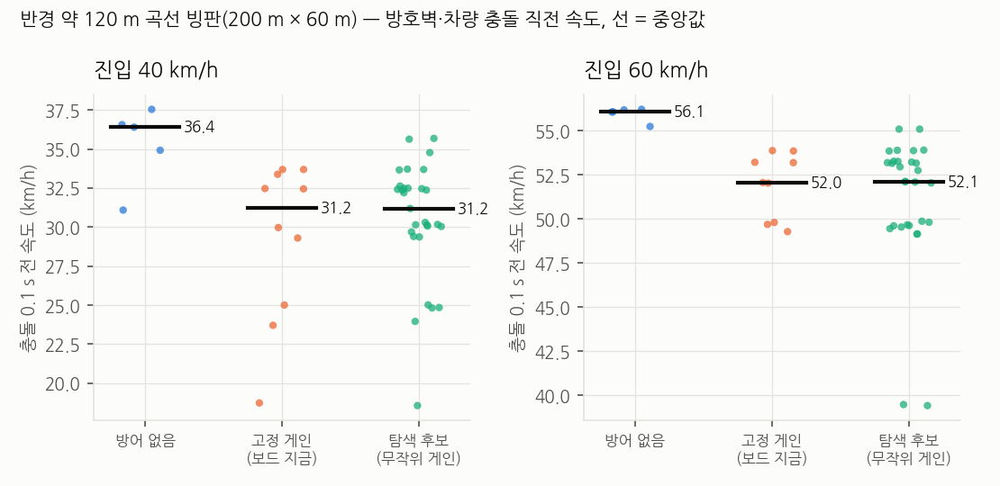

# 18. 2차 방어 확장 — 마찰 추정과 마찰별 제어표 (진행 중)

> 자동 생성: `sw/scripts/analysis/gain_sched_report.py` · 데이터: `sw/docs/data/gain_sched/` · 브랜치 `feature/gain-sched`

2차 방어의 비상 제어는 지금 **손으로 고른 고정 게인**이다 (펄스 제동 0.70/0.35, 조향 PD 1.4/0.15/0.30, 정지거리 감속 1.0 m/s²).
마찰이 달라도 같은 값을 쓴다. 이 작업은 그것을 **실시간 마찰 추정 → 마찰·속도별 제어표 조회**로 바꾸려는 것이다.
표는 시뮬레이션에서 미리 만들고 보드는 찾아 쓰기만 한다. 모든 변경은 컴파일 플래그(`SLIP_MU_EST`, `SLIP_GAIN_SCHED`, 기본 0) 뒤에 있다.

## 지금까지 된 것

| 단계 | 결과 |
|---|---|
| 1. 시뮬 = 보드 코드 | CARLA `--slip-ctypes` 가 보드 펌웨어와 **같은 `slip_core.h`** 를 ctypes 로 부른다. C = 파이썬 v7 참조 = torch 대리 제어기, 샘플 단위 동치 시험 통과 |
| 2. 마찰 보정 | CARLA friction ≤ 0.3 에서 **μ_eff ≈ 0.81 × friction**. 바퀴 잠김으로 감속이 줄지는 않는다 |
| 3. 마찰 추정기 | 마찰원 μ̂ = √(ax²+ay²)/g (펄스 강 구간만, 상승 느리게·하강 빠르게). μ_eff ≤ 0.41 전 구간에서 **1 s 안에 ±30 %** |
| 7(일부). 보드 이식 준비 | `slip_gain_lut.h` 자동 생성기, 쌍선형 보간 C 경로, 펌웨어 패처 갱신(문법 검사), **플래그 0 출력 비트 단위 동일** |
| 4. 대리 모델 | 보정·교차검증 진행 중 — **기준 미달** (아래) |
| 5·6·8 | 대리 모델 검증 뒤로 미룸 |



| friction | μ_eff | 평균 감속 m/s² (제동 0.3 / 0.5 / 0.7 / 1.0) |
|---|---|---|
| 0.02 | 0.018 | 0.17 / 0.17 / 0.17 / 0.17 |
| 0.04 | 0.034 | 0.33 / 0.33 / 0.33 / 0.33 |
| 0.06 | 0.050 | 0.49 / 0.49 / 0.49 / 0.49 |
| 0.08 | 0.066 | 0.64 / 0.64 / 0.64 / 0.64 |
| 0.12 | 0.099 | 0.96 / 0.96 / 0.96 / 0.96 |
| 0.2 | 0.164 | 1.57 / 1.60 / 1.60 / 1.60 |
| 0.3 | 0.245 | 2.06 / 2.35 / 2.40 / 2.40 |
| 0.5 | 0.408 | 2.59 / 3.08 / 3.50 / 3.97 |
| 1 | 0.673 | 2.82 / 3.56 / 4.33 / 5.41 |

friction 0.5 부터는 바퀴당 최대 제동 토크(700 N·m)가 먼저 한계에 닿는다. 그래서 마른 노면 μ_eff 는 제동으로 잰 값이다.



| friction | μ_eff | 끝 μ̂ | 오차 | ±30 % 수렴 |
|---|---|---|---|---|
| 0.02 | 0.018 | 0.020 | +13 % | 0.30 s |
| 0.04 | 0.034 | 0.031 | -8 % | 0.22 s |
| 0.06 | 0.050 | 0.049 | -3 % | 0.00 s |
| 0.08 | 0.066 | 0.065 | -2 % | 0.00 s |
| 0.12 | 0.099 | 0.098 | -1 % | 0.28 s |
| 0.2 | 0.164 | 0.163 | -1 % | 0.56 s |
| 0.3 | 0.245 | 0.245 | +0 % | 0.62 s |
| 0.5 | 0.408 | 0.422 | +4 % | 0.88 s |
| 1 | 0.673 | 0.273 | -59 % | 미수렴 |

마른 노면(friction 1.0)에서는 제동 토크가 먼저 한계라 타이어가 포화하지 않는다. 마찰원으로는 μ 를 잴 수 없고, 추정은 안전한 쪽(과소)으로 남는다.
마른 노면은 기존 '접지 회복' 판정(감속이 2.5 m/s² 이상 살아나면 마른 노면 제동거리)이 따로 처리한다.
회피로 차로를 옮기는 동안은 제동이 0.25 로 고정돼 '강' 펄스가 없어 추정이 멈춘다 — 설계상 한계로 남긴다.

## 발견 1 — CARLA 마찰 트리거 결함 (기존 결과에도 영향)



데모는 차량을 만들 때 `tire_friction = 1.0` 을 주는데 **거동에 효과가 없었다.** 마른 노면은 사실 CARLA 기본값(횡 약 2 g)이었다.
또 빙판 트리거를 **벗어나면 타이어 마찰이 그 기본값으로 돌아간다.** 옆으로 미끄러지던 차가 7 m 폭 빙판을 벗어나면 2.5 g 로 급정지했다.
그래서 기존 108회 주행의 '빙판을 벗어난 뒤' 구간은 실제보다 정지가 짧고 회복이 쉽다. 이 작업의 검증 주행은 빙판을 200 m × 60 m 로 깔아
차가 멈추거나 부딪힐 때까지 트리거를 벗어나지 않게 했다. 측정: `sw/scripts/sim/carla_friction_probe.py` (전용 서버에서).

## 발견 2 — 기록된 충돌 속도는 충격 뒤 값이었다 (README 정정)

데모가 충돌 이벤트를 처리할 때 그 틱의 속도를 적었는데, 충돌 센서 콜백은 충격 뒤에 들어온다. 방호벽 충돌에서 차이가 크다.

| 주행 | 상대 | 기록 (km/h) | 충돌 0.1 s 전 (km/h) |
|---|---|---|---|
| ClearNight_nodefense | wall | 12.0 | 42.0 |
| ClearNoon_nodefense | wall | 12.0 | 42.0 |
| ClearNoon_nodefense_60kph | wall | 16.6 | 51.8 |
| Snow_nodefense | wall | 12.0 | 42.0 |
| WetNoon_nodefense | wall | 12.0 | 42.0 |

데모는 이제 직전 틱 속도를 `speed_kph`, 충격 뒤를 `speed_after_kph` 로 남긴다. 기존 이벤트 108건은 손대지 않았다.

## 발견 3 — 곡선 빙판에서는 제동·조향 방식으로 물리 한계를 못 넘는다

Town04 시험 구간은 반경 약 120 m 곡선이다. 60 km/h 로 따라가려면 2.3 m/s² 의 횡가속이 필요한데, μ 0.07 빙판의 한계는 0.65 m/s² 다.



| 진입 | 제어 | 주행 | 충돌 직전 속도 중앙값 | 범위 |
|---|---|---|---|---|
| 40 km/h | 방어 없음 | 5 | 36.4 | 31.1 ~ 37.5 |
| 40 km/h | 고정 게인 (보드 지금) | 10 | 31.2 | 18.7 ~ 33.7 |
| 40 km/h | 탐색 후보 (무작위 게인) | 29 | 31.2 | 18.6 ~ 35.7 |
| 60 km/h | 방어 없음 | 5 | 56.1 | 55.2 ~ 56.2 |
| 60 km/h | 고정 게인 (보드 지금) | 9 | 52.0 | 49.3 ~ 53.9 |
| 60 km/h | 탐색 후보 (무작위 게인) | 29 | 52.1 | 39.4 ~ 55.1 |

2차 방어는 방어 없음보다 충돌 직전 속도를 낮추지만, 무작위로 뽑은 후보 게인 29개는 고정 게인보다 낫지 않았다.
같은 시드로 다시 녹화한 비교 영상(`sw/media/gs_f0.04_k60_g3.webp`)에서도 두 차 모두 53 km/h 로 방호벽에 부딪혔다.
μ ≤ 0.25 곡선에서는 '얼마나 빨리 속도를 줄이나'의 물리 한계(≈ μg)가 결과를 정한다. 제어표가 이길 여지는 직선·완만한 곡선, 앞차 회피 판단(정지거리 추정)에 있다.

## 4단계 — 대리 모델 (기준 미달, 진행 중)

동역학 자전거 + 축별 PhysX 형 타이어(종·횡 슬립, 마찰원) + 축별 바퀴 회전(암시적 적분) + 엔진 브레이크(CARLA 차량은 발을 떼면 1.95 m/s², 거의 뒷축) + 원호 차로.
보정 = 개루프 시험 81회 + 폐루프 주행 일부, 검증 = 보정에 안 쓴 폐루프 주행.

| 기준 (작업 지시) | 사용 범위 전체 | 보정에 안 쓴 몫 | 목표 |
|---|---|---|---|
| μ별 속도 감소량 Δv (정지 전 충돌) 오차 | μ 0.018: 29%, μ 0.034: 8%, μ 0.066: 18%, μ 0.127: 62%, μ 0.245: 146% | μ 0.018: 19%, μ 0.034: 5%, μ 0.066: 28%, μ 0.127: 87%, μ 0.245: 208% | ≤ 15 % |
| 최대 방향오차 차이 ≤ 10° 비율 (비스핀) | 56 % | 38 % | ≥ 90 % |
| 스핀 여부 일치 | 98 % | 96 % | ≥ 90 % |

곡선 빙판 주행은 전부 정지 전에 충돌해 정지거리가 없다 → 같은 비교 구간의 속도 감소량으로 감속 능력을 본다.
저마찰(μ ≤ 0.07)은 가까워졌지만 μ 0.13·0.25 와 방향오차가 기준에 못 미친다. 보정값 일부가 범위 끝에 붙는 것(조향 배율·횡 강성)은 타이어 구조가 아직 다르다는 신호다.
**작업 지시대로 대리 모델이 기준을 통과하기 전에는 제어표 탐색(5단계)으로 넘어가지 않는다.**

## 연산량 (리눅스 — RTOS 최악값 근거 아님)

| 구성 | 평균 | 99 분위 | 평균 비율 |
|---|---|---|---|
| 고정 게인 | 86 ns | 93 ns | 1.00 |
| SLIP_MU_EST | 98 ns | 93 ns | 1.14 |
| SLIP_MU_EST + SLIP_GAIN_SCHED | 97 ns | 148 ns | 1.13 |

추가 연산은 고정 횟수다(구간 찾기 비교 ≤ 14, 보간 곱 30, logf 1, sqrtf 1). 리눅스 최댓값은 스케줄러 지터가 섞여 의미가 없다 — 한 구성에서 2.2 ms 가 튀었다(문서 10 이 말하는 바로 그것).
보드 ThreadX 실측은 보드 복귀 후 같은 펌웨어(`patch_fw_slip.py --gain-sched`)로 잰다.

## 재현

```bash
python3 sw/fw/npu_lib/test_slip_core.py          # C = 파이썬 (v7 · 마찰 추정 · 제어표 경로)
python3 sw/fw/npu_lib/test_flag0_regression.py   # 플래그 0 = 작업 전 헤더, 비트 단위
python3 sw/fw/npu_lib/test_patch_fw.py           # 펌웨어 패처 세 구성 문법 검사
python3 sw/scripts/analysis/gain_sched_report.py # 이 문서와 그림
```
