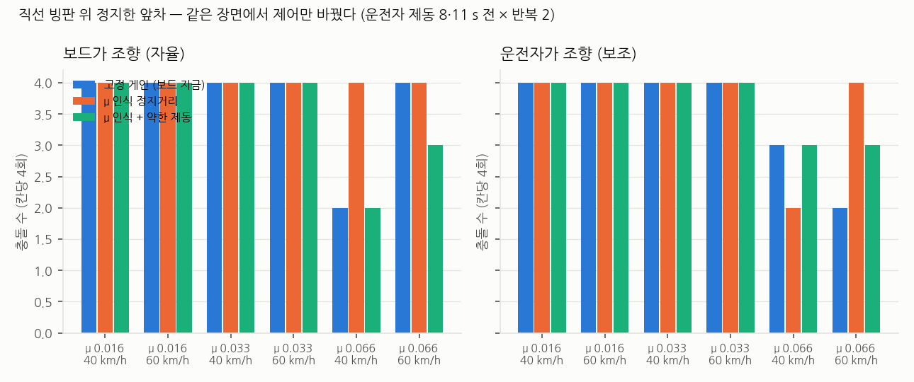
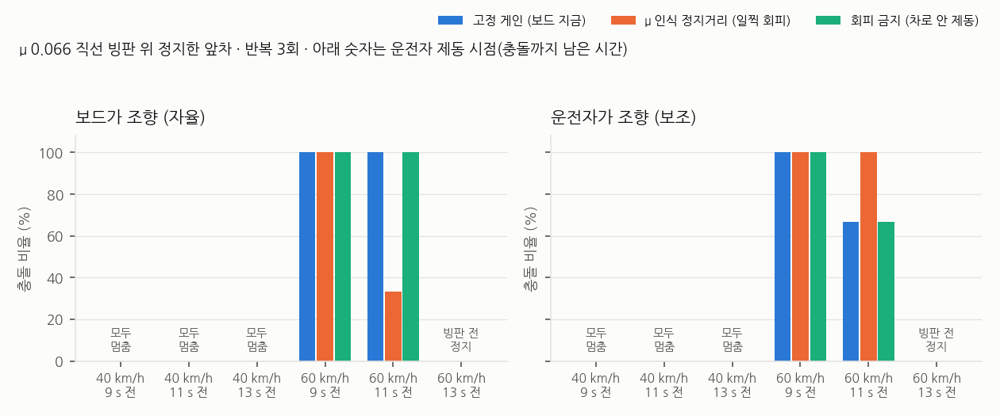
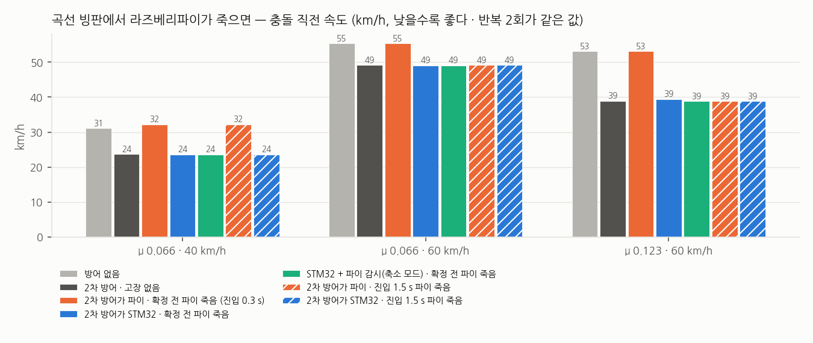

# 19. 2차 방어를 '안전 전용 RTOS'로 — 연구 계획과 CARLA 결과

> 상태: 실험 s9~s12 완료(CARLA). 표의 수치는 `sw/scripts/analysis/safety_island_report.py`(s9)·`s10_report.py`(s10~s12) 출력, 데이터는 `sw/docs/data/gain_sched/s9_summary.json`·`s10_summary.json`. 보드 ThreadX 실측은 보드 복귀 후.

## 왜 다시 잡나

이 시스템은 **자율주행이 아니라 운전자 보조 안전 장치**다. 메인 컴퓨터는 Raspberry Pi 5(리눅스, 대회 필수 보드)이고
STM32N6570-DK(ThreadX)는 **파이를 지키는 안전 전용 RTOS**로 들어왔다. 그런데 지금까지의 2차 방어 연구는 두 가지가 어긋나 있었다.

1. **출력이 자율주행식이다.** 보드가 직접 조향해 차로를 지키고 회피한다. 운전자 보조라면 조향은 운전자 몫이다.
2. **RTOS 의 가치를 응답 시간 표 한 장으로만 말했다.** 리눅스 최악 지연 5.8 ms 는 50 Hz 제어 주기(20 ms) 안에 든다 —
   지연만으로는 "그래서 결과가 달라지나"에 답하지 못한다. 안전 전용 RTOS의 진짜 가치는 **고장 격리**(파이가 죽어도 2차 방어는 산다)다.

## 세 갈래

### ① 운전자 보조로 출력 바꾸기 — 마찰별 제동 조절

조향은 운전자에게 두고 보드는 **제동만** 조절한다. 근거는 이 작업의 측정이다.

- CARLA 테슬라는 바퀴당 최대 제동 토크 700 N·m 다. μ 0.02 빙판에서 앞바퀴는 제동 0.03 만 넘어도 잠긴다.
  지금 고정 펄스(0.70/0.35)는 빙판에서 **항상 바퀴를 잠근다** → 잠긴 바퀴는 조향이 안 듣는다 → 운전자가 아무리 돌려도 소용없다.
- 그래서 마찰 μ̂ 를 알면 '바퀴가 잠기지 않는 만큼만' 제동해 **운전자의 조향권을 지키는** 제동 조절(ABS 형)이 가능하다.
- 보드의 회피 판단은 조향 대신 **안내**('왼쪽 차로 비었음')로 운전자에게 넘긴다.

구현: CARLA 데모 `--assist` — 비상 제어 중 조향은 운전자 모델(반응 0.25 s, 조향 속도 1.5/s 제한, 안내를 따라 차로 이동),
보드는 같은 C 코어의 제동 출력만 쓴다. 실험실 Moza 휠로 사람이 직접 운전하는 시험으로 이어진다(현장 필요).

### ② 리눅스 고장이 안전에 미치는 영향 — 고장 주입

같은 C 코어를 두고 **어디서 도느냐**만 바꾼다.

| 조건 | 2차 방어 위치 | 파이가 멈추면 |
|---|---|---|
| 안전 전용 RTOS | STM32 (ThreadX) | IMU 는 계속 들어오고(직결 가정) 판정·제동이 계속된다. 차선·간격 입력만 마지막 값으로 굳는다 |
| 파이 단독 | Raspberry Pi (리눅스) | 판정도 명령도 끊긴다. 액추에이터는 마지막 명령을 그대로 유지한다 |

구현: CARLA 데모 `--pi-hang START:DUR` (빙판 진입 START s 뒤 DUR s 동안 정지, `inf` 면 죽음), `--defense-host stm32|pi`.
측정: 멈춤 0.3 · 0.6 · 1.2 s · 죽음 × 위치 2 — 충돌 여부·충돌 직전 속도·정지거리.

### ③ 감시 구조 — 파이를 보는 STM32

지금 HIL 에서는 IMU 가 CARLA → 파이 → 보드로 간다. 파이가 죽으면 보드도 눈이 먼다. 실차 설계는 **IMU 를 보드에 직결**하고,
보드가 파이의 심장박동(주기 패킷)을 감시한다.

- 심장박동이 끊기면(예: 100 ms) 보드는 운전자에게 경고하고, 2차 방어만으로 동작하는 **축소 모드**로 들어간다.
- 미끄러짐 중에 끊기면 마지막 μ̂ 에 맞춘 제동 조절을 유지한다 (제어표가 여기서도 쓰인다).
- 보드 복귀 후: 펌웨어에 감시 타이머와 축소 모드를 넣고, 파이 프로세스를 실제로 죽여 응답을 잰다.

## 직선 빙판 위 정지한 앞차 — 제어표가 이길 자리

곡선 빙판에서는 곡선이 요구하는 횡가속이 μg 를 넘어 제어와 무관하게 결과가 정해졌다(18번 문서).
제어표가 차이를 낼 자리는 **판단**이다. 고정 게인은 빙판 감속을 1.0 m/s²(μ ≈ 0.1)로 가정해 정지거리를 계산한다.
μ 0.02 빙판이면 실제 정지거리를 5배 짧게 본다 → 회피해야 할 때 차선 유지를 고른다.
μ̂ 로 정지거리를 계산하면(제어표의 `a_stop_scale`) 이 판단이 바뀐다.

실험(s9): 직선·평탄 구간(`--route straight`), 빙판 200 m × 60 m, 앞차 정지 15/25/40 m, μ 3종 × 속도 2종,
고정 게인 vs μ 인식(정지거리만 μ̂ 로) × 자율 조향 / 운전자 보조.

### s9 결과 — 판단을 바꿔도 결과가 거의 같다

| 모드 | 고정 게인 충돌 | μ 인식 충돌 | μ 인식 + 약한 제동 충돌 |
|---|---|---|---|
| 보드가 조향 (자율) | 22 / 24 | 24 / 24 | 21 / 24 |
| 운전자가 조향 (보조) | 21 / 24 | 22 / 24 | 22 / 24 |

- μ 0.016·0.033 에서는 세 조건 모두 **전부 충돌**했다. 정지한 앞차까지 80 m, 운전자가 8·11 s 전에 밟아도 μg 로는 못 선다 — 판단을 바꿀 여지가 없다.
- 차이는 μ 0.066 · 운전자 제동 11 s 전 칸에서만 났고 방향이 일정하지 않다. 자율 40 km/h 에서는 고정 0/2 vs μ 인식 2/2 로 **μ 인식이 더 나빴다**.
  μ 인식은 일찍 회피를 고르는데, 회피 중 제동(B_EVADE 0.25)도 이 빙판에서는 바퀴를 잠가 조향이 듣지 않았다.
- 고장 주입(s9)은 고장 없는 기준 주행도 31 km/h 로 충돌해 비교가 되지 않았다 → s10 에서 '고장 없으면 피하는' 장면으로 다시 했다.

### s10·s11 결과 — 직선 빙판에서는 운전자가 밟은 시점이 결과를 정한다

μ 0.066 직선 빙판, 정지한 앞차, 운전자 모델이 충돌 9·11·13 s 전에 제동 0.6. 반복 3회.
세 번째 조건 **회피 금지**는 고정 게인에서 정지거리 여유를 없애 보드가 끝까지 차로 안에서 제동만 하게 했다.

| 진입 · 운전자 제동 | 고정 게인 | μ 인식 (일찍 회피) | 회피 금지 |
|---|---|---|---|
| 40 km/h · 9/11/13 s 전 | 0 / 18 | 0 / 18 | 0 / 18 |
| 60 km/h · 9 s 전 | 6 / 6 (30 km/h) | 6 / 6 (30 km/h) | 6 / 6 (30 km/h) |
| 60 km/h · 11 s 전 | 5 / 6 (19 km/h) | 4 / 6 (19 km/h) | 5 / 6 (19 km/h) |
| 60 km/h · 13 s 전 | 0 / 6 — 2차 방어 확정 전에 정지 | 0 / 6 | 0 / 6 |

s11 은 같은 장면에서 **2차 방어를 끄고** 운전자 제동만 두었다. 파이 죽음은 40 km/h 에서는 미끄러짐 확정 전, 60 km/h 에서는 확정 뒤에 걸렸다.

| 진입 · 운전자 제동 | 방어 없음 | 2차 방어 | 진입 3 s 뒤 파이 죽음 · 2차 방어가 파이 | 진입 3 s 뒤 파이 죽음 · STM32 |
|---|---|---|---|---|
| 40 km/h · 9 s 전 | 0 / 3 | 0 / 3 | 0 / 3 | 0 / 3 |
| 60 km/h · 11 s 전 | 2 / 3 (19 km/h) | 2 / 3 (19 km/h) | 3 / 3 (19 km/h) | 3 / 3 (19 km/h) |

- **직선 빙판에서 2차 방어는 운전자 제동보다 나은 점이 없었다.** 확정 0.5~6.5 s 평균 감속이 조건과 무관하게 0.066~0.068 g, 곧 μ 그 자체다.
  CARLA(PhysX) 타이어는 바퀴가 잠겨도 마찰이 줄지 않아, 펄스 제동(ABS 형)이 감속에서 이길 여지가 없다. 실제 타이어는 잠기면 마찰이 줄고 조향을 잃는다 — 이 차이는 시뮬레이터가 보여주지 못한다.
- **결과는 운전자가 밟은 시점이 정했다.** 60 km/h 에서 9 s 전이면 전부 충돌, 13 s 전이면 2차 방어가 확정하기 전에 섰다. 보드 판단 세 가지가 갈린 칸은 12칸 중 60 km/h · 11 s 전 두 칸뿐이고, 방향도 일정하지 않다(자율에서는 μ 인식이 낫고 보조에서는 나빴다).
  → 이 장면에서 사고를 줄이는 것은 **더 이른 경고(1차 방어)** 이고, 2차 방어 제어표가 아니다.
- 고장 주입(s10, 40 km/h, 파이 멈춤 0.5·1·2 s·죽음 × 위치 3 × 반복 2)은 **26회 전부 정지**했다. 위치에 따른 차이가 없는 이유는 위와 같다 — 이 장면은 2차 방어가 결과를 바꾸지 않는다.
- 회피를 고르면 결과가 나빠지는 경향은 남는다: 고정 게인이 회피를 고른 11회는 **전부 충돌**, 차로를 지킨 19회는 0회 충돌.

### s12 결과 — 곡선 빙판에서는 '어디서 도느냐'가 결과를 바꾼다

직선에서 2차 방어가 결과를 바꾸지 못했으니, 고장 주입은 **2차 방어가 결과를 바꾸는 자리**에서 해야 한다.
18번 문서의 곡선 빙판(반경 약 120 m)에서는 2차 방어가 방어 없음보다 충돌 직전 속도를 낮췄다. 같은 장면에서 파이를 죽였다(멈춤 시간 무한).
미끄러짐 확정은 빙판 진입 후 약 0.7~1 s 에 난다 → **확정 전**(진입 0.3 s)과 **동작 중**(진입 1.5 s) 두 시점. 시드 2개, 반복 두 번은 값이 같았다.

| 조건 | μ 0.066 · 40 km/h | μ 0.066 · 60 km/h | μ 0.123 · 60 km/h |
|---|---|---|---|
| 방어 없음 | 31.1 | 55.3 | 53.1 |
| 2차 방어 · 고장 없음 | 23.7 | 49.1 | 38.9 |
| 2차 방어가 **파이** · 확정 전 파이 죽음 | **32.2** | **55.3** | **53.1** |
| 2차 방어가 **STM32** · 확정 전 파이 죽음 | **23.6** | **49.0** | **39.4** |
| STM32 + 파이 감시(축소 모드) · 확정 전 파이 죽음 | 23.6 | 49.0 | 38.8 |
| 2차 방어가 파이 · 진입 1.5 s 파이 죽음 | 32.2 | 49.1 | 38.8 |
| 2차 방어가 STM32 · 진입 1.5 s 파이 죽음 | 23.6 | 49.1 | 38.8 |

(충돌 직전 0.1 s 속도, km/h. 42회 전부 충돌 — 곡선이 요구하는 횡가속이 μg 를 넘는다. 주행마다 감속/g 를 μ_eff 와 비교해 전부 통과.)

- **2차 방어가 파이에 있으면, 파이가 죽는 순간 방어 없음과 같아진다** (53.1 = 53.1, 55.3 = 55.3). STM32 에 있으면 고장 없음과 같다 (39.4 ≈ 38.9).
  μ 0.123 · 60 km/h 에서 그 차이는 **14 km/h** 다. 충돌 에너지로는 (53.1/39.4)² ≈ 1.8 배.
- **동작 중에 죽으면** 파이 쪽도 결과가 같았다. 액추에이터가 마지막 명령(차로 유지 제동)을 그대로 붙잡는다고 가정했기 때문이다.
  실제 제동 장치는 명령이 끊기면 풀리는 쪽으로 설계되는 경우가 많다 — 그 경우 파이 쪽은 '확정 전' 줄과 같아진다. 이 가정은 보수적이지 않다.
  40 km/h 에서는 진입 1.5 s 에 아직 확정 전이어서 '확정 전' 줄과 같다.
- **파이 감시 + 축소 모드**(조향 끔, 차선·간격 입력 버림, 강제동)는 결과를 나쁘게 하지 않았다. 곡선 빙판에서는 조향이 결과를 바꾸지 못하기 때문이다(18번 문서).
  보드는 파이 죽음을 0.12 s 안에 알아차렸다(5샘플 무응답).

**정리.** 이 시스템에서 STM32 의 몫은 '더 좋은 제어'가 아니라 **리눅스가 죽어도 2차 방어가 산다**는 것이고, 그 값은 2차 방어가 결과를 바꾸는 장면에서만 보인다.
직선 빙판(정지한 앞차)에서는 운전자 제동 시점이, 곡선 빙판에서는 2차 방어의 존재 여부가 결과를 정했다. 마찰별 제어표(게인 스케줄링)는 두 장면 어디에서도 고정 게인을 넘지 못했다.

**측정 함정 2 (2026-10-26 발견):** CARLA 는 마찰 트리거 안에 다른 차량이 있으면 자차가 트리거 밖에 있어도 처음부터 그 마찰을 건다.
s9~s11 은 정지 앞차를 빙판 안(중심 +80 m)에 두었으므로 자차는 **출발점부터 빙판 마찰**로 달렸다 (주행마다 감속/g = μ_eff 검사는 그래서 통과했다).
결론(운전자 제동 시점이 결과를 정한다, 2차 방어 유무 차이 없음)은 '처음부터 빙판'이라는 조건에서 여전히 성립하지만, '빙판 진입'·'빙판 전 정지'라는 표현은 틀렸다.
s12(곡선, 앞차 없음)는 영향이 없다. 이후 실험(20번 문서)은 앞차를 트리거 밖에 둔다.

**측정 함정 (s10 첫 집계):** s9(friction 0.02)를 돌리고 재기동하지 않은 서버 두 대에서 달린 주행 34개가 전부 μ 0.018 로 달렸다.
데모의 시작 정리 코드는 '남은 트리거 0개'로 보았다 — 액터 목록에 안 보이는 마찰 상태가 서버에 남는다.
그 주행은 `contaminated_2040_2050/` 로 격리하고 새로 띄운 서버에서 다시 돌렸다. 지금 집계는 주행마다 감속/g 를 μ_eff 와 비교해(±35 %) 확인한다 — 134회 전부 통과.

## 남는 한계

- CARLA 마찰 트리거를 벗어나면 마찰이 기본값으로 돌아가는 결함 때문에 '빙판 → 마른 노면' 전환은 검증하지 못한다.
- 운전자 모델은 사람이 아니다. Moza 휠 시험은 현장에서 해야 한다.
- 보드 ThreadX 실측(감시 타이머·제어표 경로)은 보드 복귀 후.
