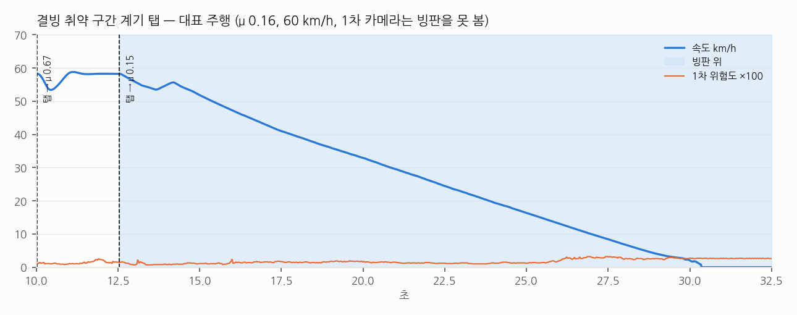

# 20. 2차 방어 — 마찰 인식 제동 시점 (SLIP_ENVELOPE)

> 수치는 `sw/scripts/analysis/env_report.py` 출력, 데이터는 `sw/docs/data/envelope/`. CARLA 0.9.16 시뮬레이션 결과다.
> STM32 보드가 없어 실시간 측정은 라즈베리파이 격리 코어 대체 구성으로 했다 (`sw/docs/data/pi_island/`).

## 왜 바꿨나

18·19번 문서의 결론: 미끄러진 뒤 브레이크·조향을 어떻게 하느냐(게인 표)는 고정값을 넘지 못했고, 펄스 제동은 실차의 ABS 와 겹친다.
결과를 정한 것은 **언제 브레이크를 밟기 시작했느냐**였다.
간격 유지·긴급제동은 앞차까지 거리와 정지 거리를 비교해 제동 시점을 정하는데, 노면 마찰을 모르면 마른 노면 감속으로 계산할 수밖에 없다. 빙판에서는 그 시점이 늦다.

그래서 2차 방어의 출력을 **"언제부터 서야 하나"** 로 바꿨다. 시연 상황은 **간격 유지 크루즈(ACC) 주행 중**이다 — 운전자 보조이고 자율주행이 아니다.

## 하는 일 (20 ms 마다, 고정 횟수 연산)

1. **노면 확인 탭** — 가속 페달을 0.2 s 떼고 브레이크를 0.3 세기로 0.4 s 밟는다. 마지막 0.25 s 평균 감속을 표(제동 0.3 실측)로 되돌려 마찰 μ 를 잰다.
   - 제동 직후 3 샘플(60 ms) 연속 마른 노면만큼 감속하면 바로 '이상 없음'으로 끝낸다 → 마른 노면에서 탭 속도 손실 13 → 5 km/h.
   - 측정값이 표 최저값보다도 낮으면(가속 중 헛돌던 바퀴 등) 한 번 다시 잰다.
   - 잰 값이 그대로 μ 가 된다 (카메라 기본값·마른 노면 가정을 덮는다. 마른 노면이면 경고 취소).
2. **탭을 할지 판단** (`env_should_probe`) — 계기 하나 + 안전 조건 전부.

   | 계기 | 조건 |
   |---|---|
   | ① 카메라 | 1차 위험도가 회색 구간(0.3 ~ 0.6)에 0.2 s 이상 → 카메라가 본 지점(19 m 앞)에 도착했을 때 |
   | ② 지도 | 결빙 취약 구간(교량·터널 출입구·그늘 — 도로 관리 기관이 지정) 안 → 2.5 s 마다 최대 3번, 빙판을 찾으면 멈춤 |

   안전 조건: 외기 3 °C 이하, 30 km/h 이상, 직진·급가감속 없음, 운전자 제동 없음, 앞차가 마른 노면 정지 거리의 2 배 이상, 카메라 계기는 탭 뒤 60 s 쉼.
   1차 위험도가 경고 문턱(0.6) 이상이면 탭 전까지 빙판 기본값 μ 0.10 으로 계산한다.
3. **표 조회** — `slip_env_table.h`: CARLA 에서 마찰 9종의 평탄 직선 실측 감속 (`build_env_table.py` 가 2단계 보정 데이터에서 생성).
4. **판단** — 정지 거리 = 지연 0.3 s × v + v² / (2 × 0.9 × 실측 감속) + 여유 4 m 를 앞 물체 간격과 비교해
   순항 · 가속 금지 · 예비 제동 · 전력 제동 · 정지 유지 중 하나. 예비 제동은 남은 거리에 딱 맞춰 서는 감속을 실측 감속으로 따라간다
   (빙판에서는 작은 제동으로도 감속이 포화되고, 발만 떼도 엔진 브레이크가 크다 — 필요하면 가속 페달까지 쓴다).


## CARLA 비교 1 — 마른 노면 기준 vs 마찰 인식

평탄 직선, 빙판 시작 +150 m 에 정지 차량, ACC 순항, 운전자 개입 없음. 두 조건 모두 **같은 C 코드**이고 마찰 값만 다르다:
비교 대상은 마른 노면 μ 고정, 2차 방어는 빙판 진입 때 탭으로 잰 μ.


| | 마른 노면 기준 | 마찰 인식 |
|---|---|---|
| 정지 | 2 / 9 | 8 / 9 |
| 충돌 | 7 / 9 (8 ~ 61 km/h) | 1 / 9 (48 km/h) |
| 정지 위치 | — | 8회 중 7회 4.1 ~ 4.2 m 앞 (목표 여유 4 m), 1회 0.8 m 앞 |

- 마찰 인식이 충돌한 1회(μ 0.10 · 80 km/h)는 표가 요구하는 거리가 295 m 로 150 m 안에서는 물리적으로 설 수 없다. 마른 노면 기준은 61 km/h.
- 탭이 잰 μ 는 실제보다 낮게 나오는 쪽으로 틀렸다 (μ 0.164 → 0.142 ~ 0.161, μ 0.246 → 0.20 ~ 0.21). 낮게 재면 일찍 밟지만, 예비 제동이 실측 감속을 따라가므로 정지 위치는 4 m 앞이다.
- 모든 주행의 출발 1~3 s 가속이 4 m/s² 이상 — 출발점은 마른 노면이었다 (아래 '측정 함정').

## CARLA 비교 2 — 탭을 언제 하나 (1차 모델 위험도 + 결빙 취약 구간)

1차 방어 모델(RoadNet)이 같은 장면의 카메라 프레임(얼음 합성 포함)을 실제로 판정했다. 결빙 취약 구간은 빙판보다 40 m 앞에서 시작하고, 시스템은 구간 안 어디가 빙판인지 모른다.



| 조건 | 탭 | 결과 |
|---|---|---|
| 빙판 μ 0.16 · 구간 정보 있음 · 60 km/h (맑은 낮 / 밤 / 젖은 날씨) | 첫 탭 마른 노면 '이상 없음' → 다음 탭에서 빙판 찾음 | 3 / 3 정지 (4.1 m 앞) |
| 빙판 μ 0.16 · 40 km/h | 탭 3번 (마른, 마른, 빙판) | 정지 |
| 빙판 μ 0.10 · 60 km/h | 탭 2번 → μ 0.10 | 정지 |
| 빙판 μ 0.16 · 80 km/h | 탭 2번 → μ 0.16 | 충돌 23 km/h (필요 182 m > 150 m. 마른 노면 기준은 47 km/h) |
| 빙판 μ 0.16 · **구간 정보 없음** | 탭 없음 | 충돌 30 km/h — 마른 노면 기준과 같다 |
| 빙판 없음 · 구간 안 · 영하 (맑은 / 젖은 날씨) | 3번 모두 '이상 없음' | 잘못된 제동 없음, 정상 정지 |
| 빙판 없음 · 영상 8 °C | 탭 없음 | — |

- **1차 모델은 이 장면들에서 빙판을 거의 보지 못했다** (위험도 최대 0.03 ~ 0.05). 직선 구간 6곳을 더 훑어도 최대 0.36, 회색 구간에 0.2 s 이상 머문 적이 없다.
  → 카메라 계기만으로는 탭이 나가지 않는다. 지도 계기(결빙 취약 구간)가 그 공백을 메운다.
- CARLA 의 젖은 날씨는 화면만 바꾸고 타이어 마찰은 그대로라, '젖은 노면' 탭은 마른 노면 값으로 나온다.

## 측정 함정 (2026-10-26)

CARLA 는 **마찰 트리거 안에 다른 차량이 있으면, 자차가 트리거 밖에 있어도 처음부터 그 마찰을 건다.**
첫 실험은 정지 차량을 빙판 안에 두어 자차가 출발점부터 빙판이었다(출발 가속이 μg 에서 막힘). 같은 트리거에서 정지 차량만 빼면 진입점부터 빙판이 된다 — 직접 확인했다.
지금은 빙판을 정지 차량 2.5 m 앞에서 끝내 정지 차량이 트리거 밖에 서게 하고, 주행마다 출발 가속을 요약에 남긴다. 위 표는 모두 고친 뒤의 결과다.
트리거 액터의 위치·회전은 (0, 0, 0) 으로 보고되어 확인에 쓸 수 없다 — 달려서 재야 한다.

## 시험

```bash
python3 sw/fw/npu_lib/test_envelope.py           # 11개: 탭→μ, 재측정, 일찍 끝내기, 정지 거리 식, 전력 제동, 탭 판단(카메라·온도·구간·확신)
python3 sw/fw/npu_lib/test_flag0_regression.py   # 플래그를 끄면 작업 전과 비트 단위로 같다
python3 sw/fw/pi_island/test_island.py           # 파이 격리 코어 = ctypes 코어, 심장박동 끊김 → 축소 모드
python3 sw/scripts/sim/carla_envelope.py --arm mu --camera-risk --video   # CARLA 장면 (서버 필요)
```

## 한계

- 탭은 운전자가 느낀다 (마른 노면 5 km/h 손실). 연구에는 앞축 구동 + 뒷축 제동으로 차 전체 가속을 바꾸지 않고 마찰만 재는 방법이 있다 — 다음 단계.
- 노면 마찰 추정 자체는 연구와 일부 양산차(바퀴 속도 기반 경고·클라우드 공유)에 있는 기술이다. 이 작업이 더한 것은 카메라·지도 계기로 '확인할 때'를 정하고, 잰 값을 바로 제동 시점에 쓰고, 그 루프를 메인 컴퓨터와 분리한 것이다.
- 1차 카메라 모델이 이 CARLA 장면에서 빙판을 거의 못 본다. 카메라 계기는 단위 시험으로만 확인했다.
- 결빙 취약 구간은 시나리오가 정한 위치다 (실제로는 도로 관리 기관 목록을 지도에 넣는다).
- 표와 감속은 CARLA 차량(Tesla Model 3, 제동 토크 700 N·m) 기준이다. CARLA 타이어는 바퀴가 잠겨도 마찰이 줄지 않는다.
- 실차의 간격 유지·긴급제동을 직접 바꿀 수는 없다. 실차에서는 이 값을 그 장치에 넘기는 구조다.
- STM32 ThreadX 실측은 보드가 없어 하지 못했다. 같은 C 코드를 파이 격리 코어(SCHED_FIFO, 코어 3)에서 돌린 지연은 최대 0.06 ms (6,000 샘플, 전 코어 부하).
