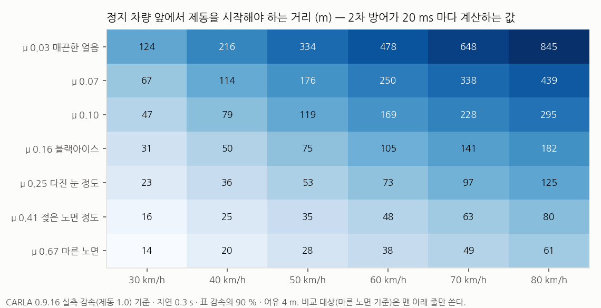
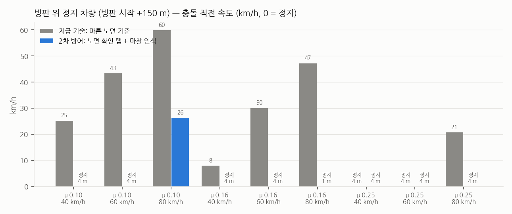

# 20. 2차 방어 — 마찰 인식 제동 시점 (SLIP_ENVELOPE)

> 수치는 `sw/scripts/analysis/env_report.py` 출력, 데이터는 `sw/docs/data/envelope/`. CARLA 0.9.16 시뮬레이션 결과다.
> STM32 보드가 없어 실시간 측정은 라즈베리파이 격리 코어 대체 구성으로 했다 (`sw/docs/data/pi_island/`).

## 왜 바꿨나

18·19번 문서의 결론: 미끄러진 뒤 브레이크·조향을 어떻게 하느냐(게인 표)는 고정값을 넘지 못했고, 펄스 제동은 실차의 ABS 와 겹친다.
결과를 정한 것은 **언제 브레이크를 밟기 시작했느냐**였다.
지금의 간격 유지·긴급제동은 마른 노면 감속으로 정지 거리를 계산한다. 빙판에서는 그 시점이 늦다.

그래서 2차 방어의 출력을 **"언제부터 서야 하나"** 로 바꿨다.

## 하는 일 (20 ms 마다, 고정 횟수 연산)

1. **노면 확인 탭** — 1차 방어가 빙판인지 애매할 때(위험도가 경고 문턱 아래 회색 구간), 가속 페달을 0.2 s 떼고 제동 0.3 을 0.4 s 건다.
   마지막 0.25 s 평균 감속을 표(제동 0.3 실측)로 되돌려 마찰 μ 를 잰다. 마른·젖은 노면이면 μ 를 바꾸지 않는다.
   측정이 표 최저값보다도 낮으면(바퀴 헛돎 등) 한 번 다시 잰다.
2. **표 조회** — `slip_env_table.h`: CARLA 에서 마찰 9종의 평탄 직선 실측 감속 (`build_env_table.py` 가 2단계 보정 데이터에서 생성).
3. **판단** — 정지 거리 = 지연 0.3 s × v + v² / (2 × 0.9 × 실측 감속) + 여유 4 m 를 앞 물체 간격과 비교해
   순항 · 가속 금지 · 예비 제동 · 전력 제동 · 정지 유지 중 하나. 예비 제동은 남은 거리에 딱 맞춰 서는 감속을 실측 감속으로 따라간다
   (빙판에서는 작은 제동으로도 감속이 포화되고, 발만 떼도 엔진 브레이크가 크다 — 필요하면 가속 페달까지 쓴다).



## CARLA 비교 — 빙판 위 정지 차량

평탄 직선, 빙판 260 m (시작 +150 m 에 정지 차량), 자차는 간격 유지 순항, 운전자 개입 없음. 1차 방어는 놓쳤다고 가정했다.
두 조건 모두 **같은 C 코드**이고 마찰 값만 다르다: 비교 대상은 마른 노면 μ 고정, 2차 방어는 빙판 진입 때 탭으로 잰 μ.



| | 마른 노면 기준 | 노면 확인 탭 + 마찰 인식 |
|---|---|---|
| 정지 | 2 / 9 | 8 / 9 |
| 충돌 | 7 / 9 (8 ~ 60 km/h) | 1 / 9 (26 km/h) |
| 정지 위치 | — | 8회 중 7회 4.1 ~ 4.2 m 앞 (목표 여유 4 m), 1회 0.6 m 앞 |

- 2차 방어가 충돌한 1회(μ 0.10 · 80 km/h)는 표가 요구하는 거리가 295 m 로 150 m 안에서는 물리적으로 설 수 없다. 충돌 속도는 60 → 26 km/h.
- 탭이 잰 μ 는 실제보다 낮게 나오는 쪽으로 틀렸다 (μ 0.164 → 0.142 ~ 0.157, μ 0.246 → 0.20 ~ 0.21, μ 0.098 at 80 km/h → 0.059).
  낮게 재면 일찍 밟지만, 예비 제동이 실측 감속을 따라가므로 정지 위치는 여전히 4 m 앞이다.
- 같은 시드·같은 장면을 녹화한 비교 영상: `sw/media/env_dry_vs_mu.webp` (위: 30 km/h 충돌, 아래: 4.1 m 앞 정지).

## 시험

```bash
python3 sw/fw/npu_lib/test_envelope.py           # 탭 → μ (8칸 최대 오차 0.28 %), 재측정, 정지 거리 식, 전력 제동
python3 sw/fw/npu_lib/test_flag0_regression.py   # 플래그를 끄면 작업 전과 비트 단위로 같다
python3 sw/fw/pi_island/test_island.py           # 파이 격리 코어 = ctypes 코어, 심장박동 끊김 → 축소 모드
python3 sw/scripts/sim/carla_envelope.py --arm mu --video   # CARLA 장면 (서버 필요)
```

## 한계

- 탭은 운전자가 '툭' 하고 느낀다. 1차 방어가 애매할 때·외기 온도가 낮을 때만 켜야 한다. 이 장면은 탭 시점을 빙판 진입 위치로 정했다(1차 방어 회색 구간을 대신).
- 1차 방어가 완전히 놓치고 탭도 안 나가면, 실제로 미끄러질 때까지 2차 방어는 μ 를 모른다.
- 표와 감속은 CARLA 차량(Tesla Model 3, 제동 토크 700 N·m) 기준이다. CARLA 타이어는 바퀴가 잠겨도 마찰이 줄지 않는다.
- 실차의 간격 유지·긴급제동을 직접 바꿀 수는 없다. 실차에서는 이 값을 그 장치에 넘기는 구조다.
- STM32 ThreadX 실측은 보드가 없어 하지 못했다. 같은 C 코드를 파이 격리 코어(SCHED_FIFO, 코어 3)에서 돌린 지연은 최대 0.06 ms (6,000 샘플, 전 코어 부하).
