# 1차 방어 시연용 노면 사진

RealSense 로 비춰 1차 방어 모델이 판정하는지 보는 용도다. 맥북·태블릿에 **전체 화면**으로 띄우고, 카메라를 30~50 cm 거리에서 화면에 맞춘다.
모델은 흐림에 약하다 — 화면 밝기를 올리고, 반사·무아레가 생기면 각도를 조금 틀어 본다.

출처: RSCD (Road Surface Condition Dataset) 검증 세트 — 블랙박스 영상에서 노면만 잘라 낸 360×240 패치라 원래 작다. 이 폴더의 사진은 3배로 키운 것이고, `original/` 은 원본 크기다. 연구·시연 목적의 인용.

**띄우는 요령** — 전체 화면으로 키우면 흐려져 판정이 떨어진다. 원본~2배 크기로 띄우고 카메라를 가까이 대서 사진이 판정 네모를 꽉 채우게 한다 (모델은 224×224 로 줄여서 본다).
각 사진은 원본·2배 확대+흐림·가운데 자르기 세 경우 모두 모델이 96 % 이상으로 맞힌 것만 골랐다.

## 마른 노면

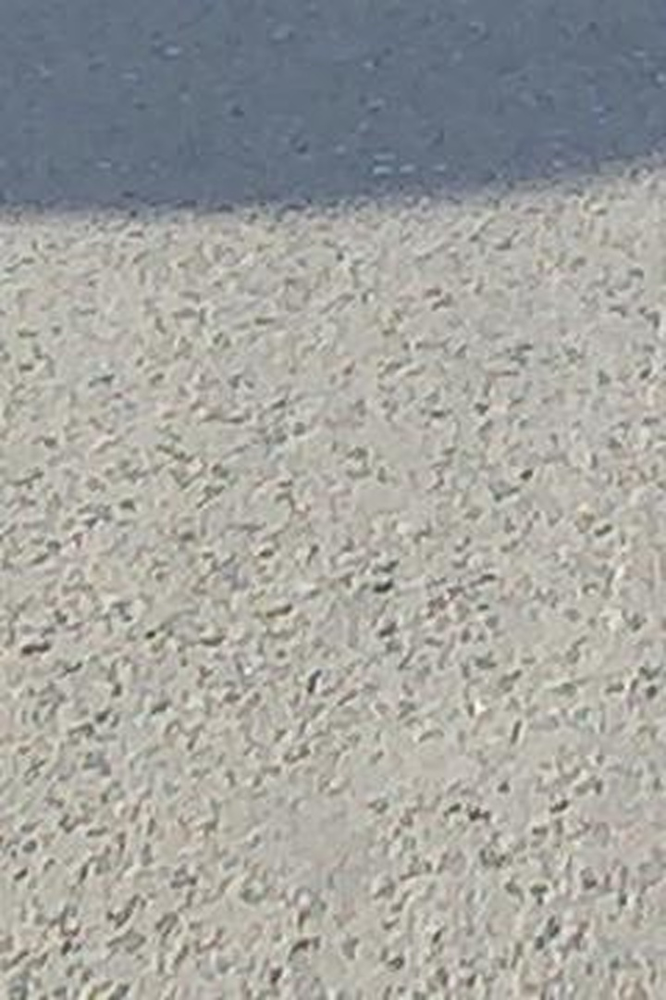
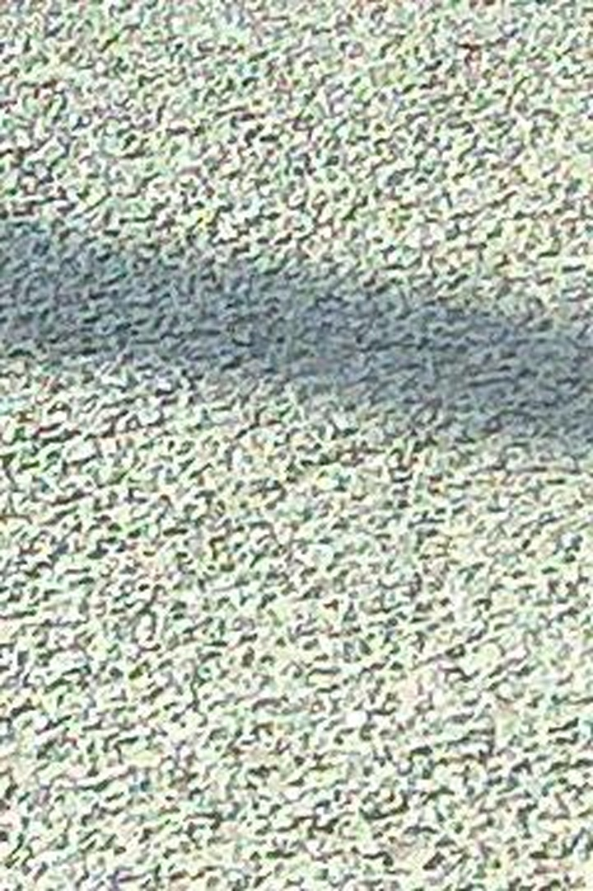
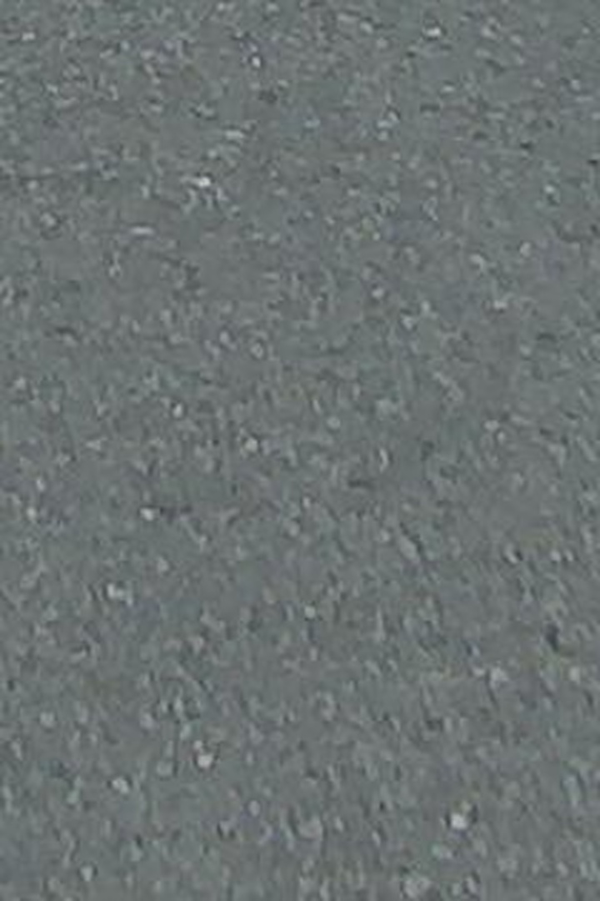
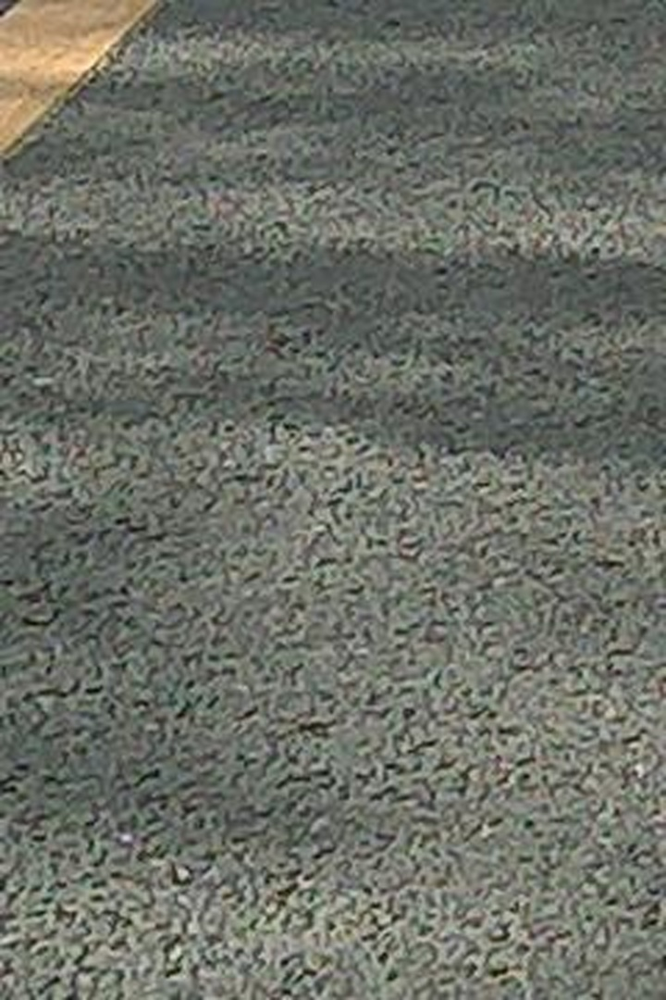

## 블랙아이스(얼음)

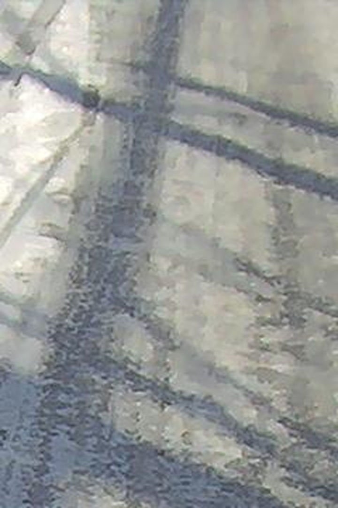
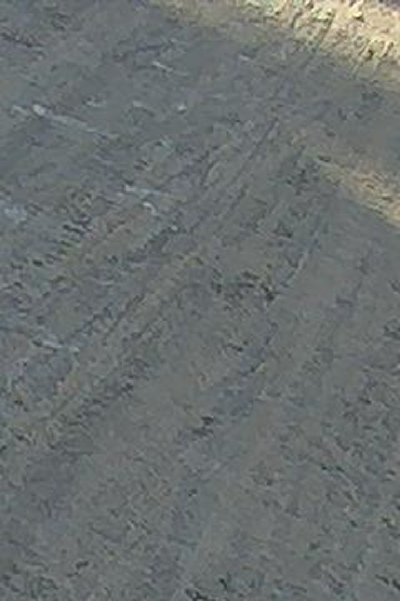
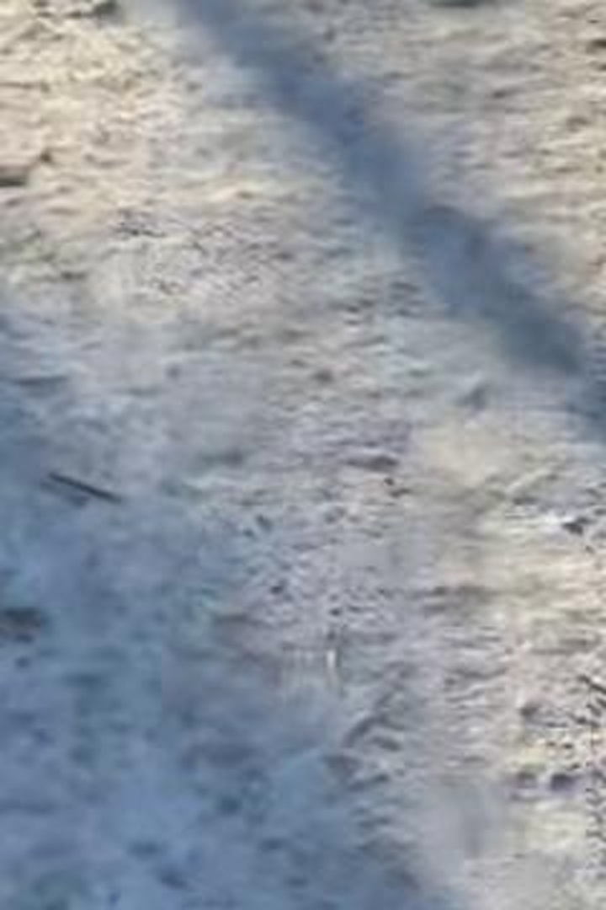
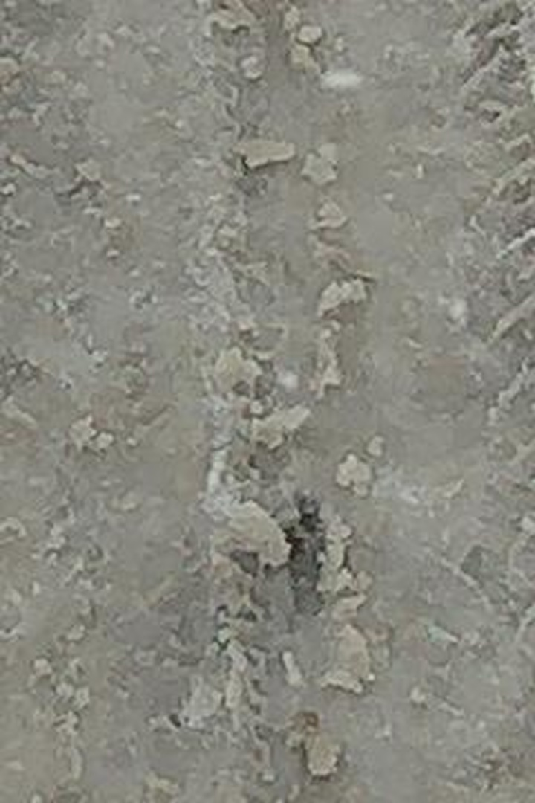

## 젖은 노면

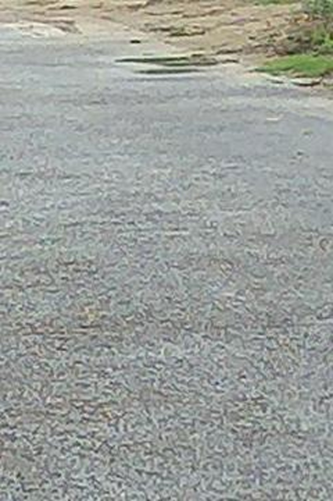
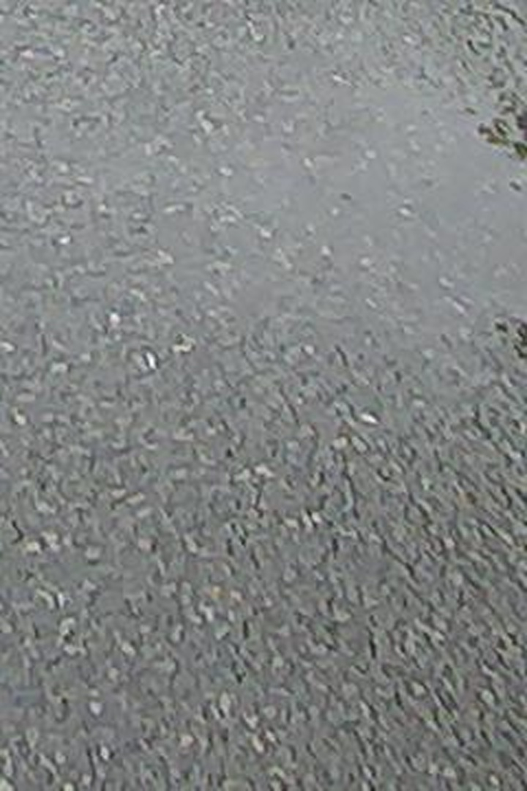
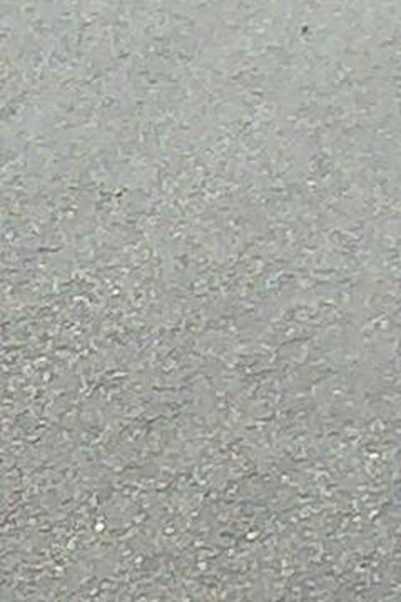
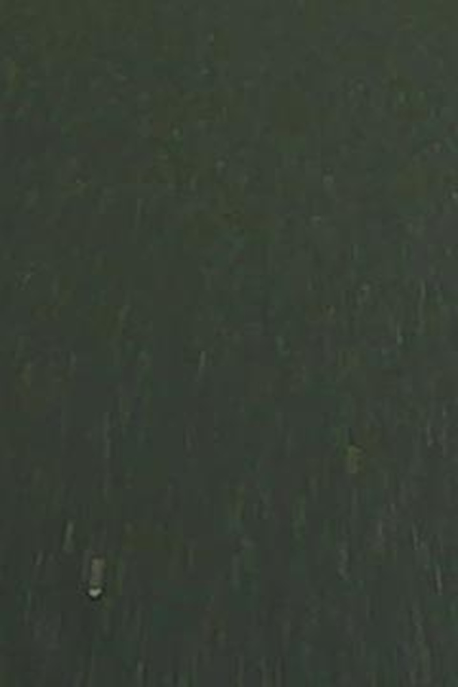
